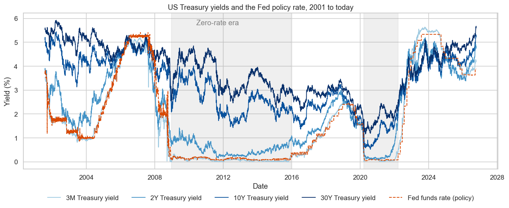
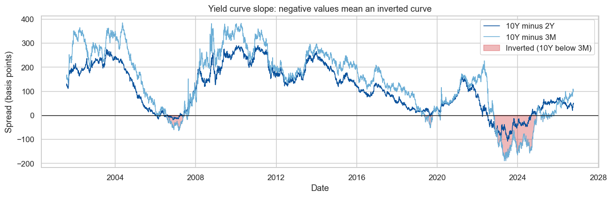
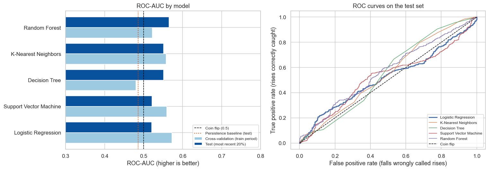
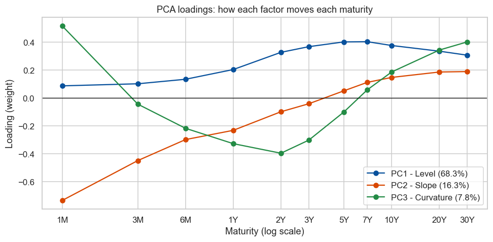
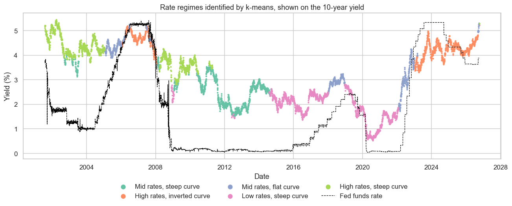
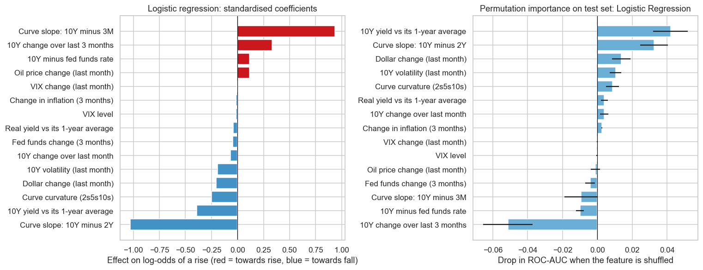
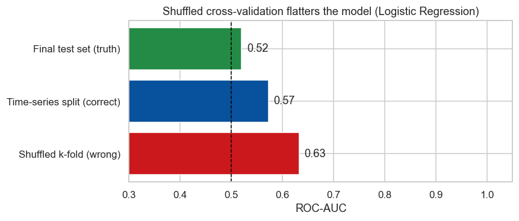
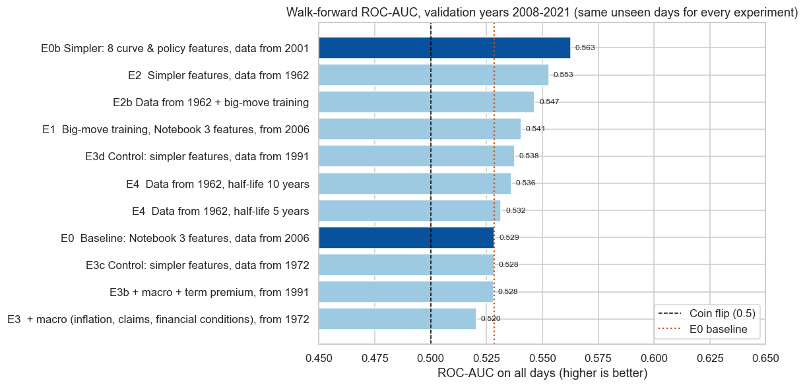
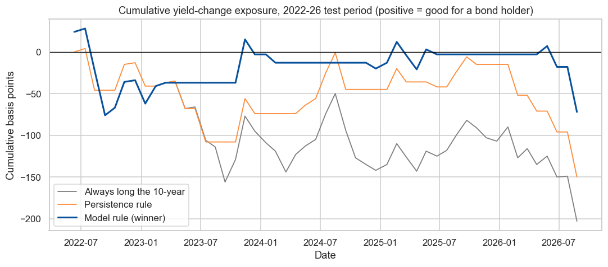
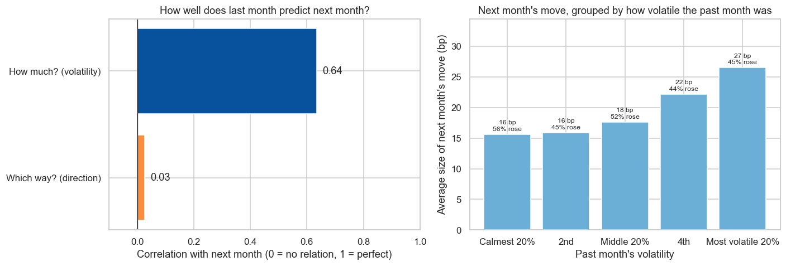

# Will US Interest Rates Rise or Fall Next Month?
### Predicting the direction of the 10-year US Treasury yield with machine learning

**Author:** Arun Kumar Pandey
**Programme:** Post Graduate Program in AI and Machine Learning — Capstone Project

---

## Executive summary

**The question.** The 10-year US Treasury yield is the world's benchmark interest rate. When it rises, bond portfolios
lose value. This project asks whether today's shape of the yield curve, the Federal Reserve's policy rate, inflation
expectations and market fear can predict **whether the 10-year yield will be higher or lower one month (21 trading
days) from now**, and whether they do it better than simple rules of thumb.

**The answer, in one line.** Not reliably. Across 20 years of daily data and five tuned machine-learning models, the best
model was right about **51% of the time** on the most recent four years (mid-2022 to 2026). That is about the same as
the simple rule "assume last month's direction continues" (51.5%). This **negative result** is honest, and it matches
decades of research showing that the US Treasury market is close to efficient: public information is already in the
price.

**What *did* work.**

- **Three factors explain about 92% of all daily moves in the yield curve**: the whole curve shifting up or down
  (**level**, 68%), the curve getting steeper or flatter (**slope**, 16%) and the middle bending (**curvature**, 8%).
- **The size of next month's move is predictable, even though its direction is not.** Last month's volatility is
  strongly related to next month's (correlation 0.64), while last month's direction is not related at all (0.03).
  After the most turbulent months, the next move was about 70% larger on average.
- The curve falls into **five recognisable "rate regimes"** that match chapters of Federal Reserve history. The odds of
  a rise next month differ by regime: about 40% in one, about 53% in another.
- Two common mistakes that make models look far better than they are were **caught, measured and documented** (see
  [Findings](#findings)).

**Can it be improved? (Notebook 4)** Eleven improvement ideas were screened fairly on the same unseen years. The best
one was to **simplify**: a model using just 8 yield-curve and policy-rate features, re-trained every year, raised the
test score (ROC-AUC) from **0.52 to 0.575**, and to **0.61 on months with big moves**. When it was confident it was right
**70% of the time** (23 of 51 months). The evidence is promising but not yet conclusive, because four years is a short
test.

---

## Rationale — why this matters

- **Everything is priced off this curve.** Mortgages, corporate bonds, swaps and emerging-market bonds, including Indian
  government bonds, are priced relative to US Treasury yields.
- **Rate moves hit balance sheets directly.** Banks, insurers and pension funds hold large bond portfolios. In March
  2023, Silicon Valley Bank failed after rising rates cut the value of its bond holdings. A reliable view on rate
  direction would help such institutions decide how much interest-rate risk to keep and how much to hedge.
- **Knowing that you *can't* predict something is valuable too.** If a well-built model cannot beat a simple rule, the
  right response is to **hedge rate risk rather than try to time it**.

## Research question

> Can the shape of the US Treasury yield curve, together with monetary policy, inflation and risk-sentiment data,
> predict the **direction** of the 10-year Treasury yield one month ahead more accurately than simple benchmarks?

Supporting questions:
1. How many underlying factors drive the yield curve, and are they stable over time? *(Notebook 2)*
2. Does the curve fall into distinct, recognisable rate regimes? *(Notebook 2)*
3. Can a supervised classifier beat naive benchmarks out of sample? *(Notebook 3)*

---

## 1. Problem statement

**Goal:** for each trading day, predict whether the 10-year US Treasury yield will be **higher (1) or not (0)** in 21
trading days.

**Challenges:**
- Bond markets are heavily traded and highly efficient, so any predictable pattern is small and quickly traded away.
- Market behaviour changes between policy regimes (e.g. the zero-interest-rate years of 2008–2015).
- Financial time series make it easy to "accidentally cheat" by letting a model see the future during testing.

**Potential benefit:** a probability of "yields up next month" that portfolio managers and treasury teams could use as
one input when sizing interest-rate risk and hedges.

## 2. Model outcomes — type of learning

| Part | Type of learning | Output |
|---|---|---|
| Main task | **Supervised, binary classification** | Probability that the 10-year yield is higher in 21 trading days, and an up/down call |
| Supporting analysis | **Unsupervised**: PCA (dimensionality reduction) and k-means (clustering) | The main factors driving the curve, and a label for each day's rate regime |

## 3. Data acquisition

All data comes from **[FRED](https://fred.stlouisfed.org)** (Federal Reserve Bank of St. Louis), which republishes the
Federal Reserve's official H.15 interest-rate data. It is free and authoritative. The sample runs from **August 2001 to
October 2026**: 6,299 trading days.

| Data | FRED series | Why it is included |
|---|---|---|
| Treasury yields at 11 maturities (1 month to 30 years) | `DGS1MO` … `DGS30` | The yield curve itself |
| Fed funds rate | `DFF` | The central bank's policy rate |
| 10-year breakeven inflation | `T10YIE` | What the market expects inflation to be |
| VIX | `VIXCLS` | Stock-market "fear gauge": risk sentiment |
| Brent crude oil | `DCOILBRENTEU` | Energy-driven inflation pressure |
| Broad US dollar index | `DTWEXBGS` | Global demand for dollar assets |
| Consumer Price Index | `CPIAUCSL` | Actual inflation (monthly) |
| *Notebook 4 only:* Kim–Wright 10-year term premium | `THREEFYTP10` | Extra yield investors demand for holding long bonds |
| *Notebook 4 only:* initial jobless claims | `ICSA` | The most timely read on the labour market (weekly) |
| *Notebook 4 only:* Chicago Fed financial conditions | `NFCI` | How tight or loose financial conditions are (weekly) |

Using several sources lets the model see both **what the bond market is pricing** (the curve) and **the forces that move
it** (policy, inflation, risk appetite, oil, the dollar).



*Yields fell for most of two decades, sat near zero after 2008 and again during COVID, then jumped in 2022–23 in the
fastest Fed tightening cycle in four decades. Very different "eras" in one dataset are the core difficulty of this
problem.*



*The curve was inverted (short rates above long rates, a classic recession warning) on 15.6% of days, mostly in
2006–07 and 2022–24.*

## 4. Data preprocessing and preparation

**a. Missing values and inconsistencies**
- **Calendar alignment:** different series follow different holiday calendars (oil follows London, fed funds is
  published on weekends). All data was aligned to US Treasury trading days.
- **Gap audit:** for every series the notebook reports coverage, the longest gap, and the longest run of identical
  values (a frozen data feed would show up here). Only gaps of up to 5 days (holiday mismatches) were filled, by carrying
  the last value forward. Longer gaps were never filled.
- **Download integrity check:** an earlier version of this project silently received a truncated download of one series
  (219 rows instead of about 6,000), which shrank the dataset and produced a fake "perfect" model. The notebook now
  **stops with an error** if any series covers less than half of the sample, or if dropping incomplete rows would remove
  more than half the data.
- **No look-ahead bias:** monthly inflation (CPI) is only used from the 15th of the following month, when it is actually
  published.

**b. Train/test split**
- The data was split **in time order, never shuffled**. The model trains on February 2006 to May 2022 (4,071 days) and
  is tested on **June 2022 to September 2026** (1,023 days), the most recent 20%.
- A **21-day gap** separates training from testing, because each target looks 21 days ahead.
- Inside the training data, hyperparameters were tuned with **time-series cross-validation**: 5 folds, each training on
  the past and validating on the following period.

**c. Feature engineering and encoding**
- 15 numeric features: curve **slope** and **curvature**, 10-year **momentum** and **volatility**, the gap between the
  10-year and the **policy rate**, change in the policy rate, **real yield** and **inflation** changes, **VIX**, **oil** and
  **dollar** moves.
- **Levels were converted into deviations from their 1-year average.** Statistical testing (Augmented Dickey-Fuller)
  showed the yield level trends over time. A model given raw levels learned "high yields are followed by falls" from
  the 2006–2021 decline, and that pattern broke in 2022.
- All features are numeric, so no categorical encoding was needed. Features were **standardised** inside each model
  pipeline, so scaling is learned only from training data.
- The target is balanced overall (49% rises, 51% falls), so no re-sampling was needed.

## 5. Modeling

Five classification algorithms were compared, each in a `StandardScaler` + classifier pipeline, with hyperparameters
tuned by **`GridSearchCV`** and **`TimeSeriesSplit`** cross-validation:

| Model | What it does | Hyperparameters searched |
|---|---|---|
| Logistic regression | Weighted sum of features → probability; easy to interpret | Regularisation strength `C`, L1 vs L2 penalty |
| K-nearest neighbours | Looks at the most similar past days | Number of neighbours, distance weighting |
| Decision tree | A flowchart of if/then rules | Maximum depth, minimum samples per leaf |
| Support vector machine (RBF) | Finds a flexible boundary between up and down days | `C`, `gamma` |
| Random forest | Averages 300 decision trees | Depth, leaf size, features per split |

These were benchmarked against two simple rules: **always predict the most common outcome**, and **persistence**
("last month's direction continues").

## 6. Model evaluation

**Main metric: ROC-AUC.** It measures how well the model ranks days by how likely a rise is: **0.5 = coin flip, 1.0 =
perfect**. It was chosen because (1) a portfolio manager uses the model's *confidence*, not just a yes/no call; (2) it
does not depend on picking a 0.5 cut-off, and the right cut-off depends on each user's cost of being wrong; and (3) it is
not distorted by the share of up and down months, which swings widely from year to year. **Accuracy** (share of correct
calls) is reported alongside because it is easy to explain. In a market this efficient, a realistic target is 0.55–0.65;
anything above 0.70 would be treated as a bug.

**How the winner was chosen:** the model with the best **cross-validated** AUC. The test set was used only once, to
report the result, never to choose.

| Model | Cross-validated ROC-AUC | Test ROC-AUC | Test accuracy |
|---|---|---|---|
| **Logistic regression (selected)** | **0.572** | **0.520** | **51.2%** |
| Support vector machine | 0.559 | 0.521 | 52.9% |
| K-nearest neighbours | 0.557 | 0.551 | 49.4% |
| Random forest | 0.522 | 0.565 | 49.2% |
| Decision tree | 0.480 | 0.551 | 57.5% |
| *Baseline: persistence* | – | 0.486 | 51.5% |
| *Baseline: majority class* | – | 0.500 | 46.1% |



**How to read this.** Every model's ROC curve sits close to the diagonal "coin flip" line. The decision tree's 57.5%
test accuracy looks attractive, but it had the *worst* cross-validation score. Choosing it because of the test result
would be choosing with the answer sheet, and its weak validation suggests the test result is luck. On about 50
truly independent months in the test period, the selected model and persistence were tied (53% each).

---

## Findings

### Finding 1 — The bond market is hard to beat at a one-month horizon
No model reliably beat the simple persistence rule on unseen data. **Actionable:** treat rate direction as essentially
unpredictable over a month with public data. **Manage interest-rate risk by hedging and diversifying rather than by
trying to time the market.**

### Finding 2 — Three factors explain about 92% of yield-curve movements


Most days the whole curve moves up or down together (level, 68%). Most of the rest is the curve steepening or
flattening (slope, 16%) or bending in the middle (curvature, 8%). **Actionable:** risk reports and stress tests can
describe rate risk with **three numbers instead of eleven**, and hedges can be built for each factor separately.

### Finding 3 — The curve moves differently under different policy regimes
During the zero-rate years (2008–2015), short-term yields almost stopped moving: daily volatility of the 3-month yield
fell from 7 basis points to about 1. Clustering found five recognisable regimes:



**Actionable:** risk models and back-tests should be **checked regime by regime**. A model calibrated in one regime
can fail in the next, as the prediction models in this project did after 2022.

### Finding 4 — What the model paid attention to is economically sensible


The most useful inputs were **where the 10-year sits relative to its 1-year average** (yields well above their recent
average tended to fall back), the **shape of the front of the curve**, recent **volatility**, and moves in the **dollar**.
**Actionable:** if rate signals are monitored at all, these are the ones to watch. Treat them as context, not as
trading triggers.

### Finding 5 — Two easy mistakes can make a useless model look good


1. **Shuffled testing:** testing with randomly shuffled days, the textbook default, scored the model at **0.63 AUC**.
   On genuinely future data it scored **0.52**.
2. **Trending inputs:** feeding raw yield levels produced models that looked good in validation (AUC about 0.60) and
   then **failed** in 2022–26, because they had learned the 20-year decline in rates.

**Actionable:** any rate-forecasting model, from a vendor or built in-house, should be **validated strictly forward in
time** and **checked across regimes** before anyone relies on it. An unusually high score is a reason for suspicion.

### Finding 6 — Simpler beats richer, and confidence matters (Notebook 4)
To improve the prediction fairly, every idea was tested on **the same 14 unseen years (2008–2021)**. For each year, the
model was trained only on earlier data. All ideas used the same simple model, and every attempt was logged. The winner
was picked by a rule fixed in advance, then tested **once** on 2022–26.



| Idea tested | Result |
|---|---|
| **Use fewer, simpler features** (8 curve and policy-rate features instead of 15) | **Best: 0.563 vs 0.529 baseline** |
| Train only on big moves (±15bp or more) | Small gain (0.541) |
| Use history back to 1962, which adds a rising-rate era | No gain (0.553) |
| Add inflation momentum, jobless claims, financial conditions, term premium | No gain; slightly worse |
| Give recent years more weight | No gain |

**On the 2022–26 test** the simpler model reached ROC-AUC **0.575**, against 0.520 for the Notebook 3 model, and
**0.614 on big-move months**. A statistical check (block bootstrap) puts the likely range at roughly 0.48–0.66, so luck
cannot be fully ruled out. When the model was at least 55/45 confident (23 of 51 months), it was right **70%** of the
time.



As a practical test, a bond holder who stepped out of the 10-year whenever the model predicted a rise would have avoided
about **130 of the 203 basis points** of yield increases in 2022–26, beating the persistence rule. **Actionable:** if a
signal like this is used at all, keep it **simple**, **re-train it regularly** and **act only on confident calls**. Extra
data feeds are not automatically better.

### Finding 7 — You can't predict which way rates will move, but you can predict how much (Notebook 4)


Last month tells us almost nothing about next month's **direction** (correlation 0.03). But it tells us a lot about
next month's **size**: last month's volatility and next month's are strongly related (correlation 0.64 overall, 0.64
in the training period and 0.57 in the test period). After the calmest 20% of months, the 10-year moved about 16bp the
following month. After the most volatile 20%, it moved about 27bp. In every group, the share of rises stayed close to
50%.

**Actionable:** scale **position sizes, risk limits and hedge ratios to expected volatility**. Even without a view on
direction, a desk can know *when* an unhedged position is most dangerous, and cut or hedge it ahead of turbulent
periods.

---

## Recommendations

1. **Do not use any of these models as a stand-alone signal to take interest-rate positions.** The best (simplified)
   model shows a promising edge, but four years of testing is not enough to rely on it. At most, use its **confident
   calls as one input** to hedging decisions, and track its record live before giving it more weight.
2. **Scale risk to expected volatility.** Recent volatility is a reliable guide to the size of next month's moves, so
   use it to set position sizes, limits and hedges.
3. **Use the factor (level/slope/curvature) and regime framework for risk management**: reporting, stress-testing and
   choosing comparable historical periods for scenarios.
4. **Ask for time-ordered, regime-by-regime validation** whenever a forecasting model is proposed, and benchmark it
   against a naive rule.

## Next steps

- **Add information that is not already in market prices**: Fed communication (FOMC statements and minutes) scored
  for hawkish or dovish tone with NLP, Fed funds futures, and Treasury-futures positioning. Public macro data alone did
  not help (Notebook 4).
- **Keep testing the simplified model forward in time** (paper-trading month by month), so its record is built on
  truly unseen data.
- **Model each regime separately**, re-fitting the regime labels and models step by step through time
  (walk-forward) so no future information is used.
- **Extend the duration-rule test** with transaction costs and position sizing based on the model's confidence.
- **Try other horizons** (1 week, 3 months), where the balance between noise and signal may differ.
- **Apply the same pipeline to the Indian government bond curve**, for which the US 10-year is a key external driver.

---

## Repository structure and how to run

```
├── README.md                                   ← this report
├── requirements.txt                            ← Python package versions
├── data/
│   ├── raw/                                    ← FRED downloads (yields, fed funds, controls, VIX, CPI, macro)
│   └── processed/                              ← outputs of Notebook 1 used by Notebooks 2–4
├── images/                                     ← charts used in this README
└── notebooks/
    ├── 1_data_cleaning_and_eda.ipynb
    ├── 2_yield_curve_pca_and_regimes.ipynb
    ├── 3_modeling_and_evaluation.ipynb
    └── 4_improvement_experiments.ipynb
```

| Notebook | Contents |
|---|---|
| [1. Data cleaning and EDA](notebooks/1_data_cleaning_and_eda.ipynb) | Loading, data-quality audit, feature engineering, visual exploration, descriptive and inferential statistics |
| [2. Yield curve PCA and regimes](notebooks/2_yield_curve_pca_and_regimes.ipynb) | PCA of curve movements, stability across policy periods, k-means rate regimes |
| [3. Modeling and evaluation](notebooks/3_modeling_and_evaluation.ipynb) | Baselines, five tuned classifiers, evaluation, interpretation, stress tests |
| [4. Improvement experiments](notebooks/4_improvement_experiments.ipynb) | Walk-forward screening of 11 improvement ideas, one-time test of the winner, bootstrap confidence interval, duration-rule test, predictability of the size of moves |

**To reproduce:** `pip install -r requirements.txt`, then run the notebooks in order (1 → 4) from the `notebooks`
folder. Notebook 3 takes about a minute; the others take seconds.

**Data licence:** FRED data is free to use with attribution: Federal Reserve Bank of St. Louis, FRED; Board of
Governors of the Federal Reserve System (H.15); ICE Benchmark Administration (Brent); Chicago Board Options Exchange
(VIX); US Bureau of Labor Statistics (CPI); US Department of Labor (jobless claims); Federal Reserve Bank of Chicago
(NFCI); Kim and Wright, Federal Reserve Board (term premium).

## Contact

Arun Kumar Pandey
